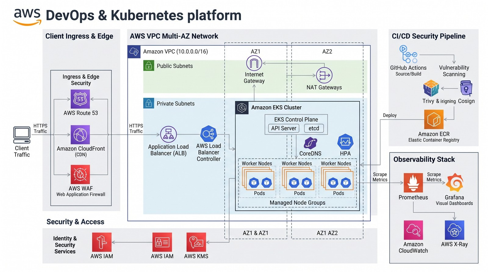

# :rocket: Kyverno Kubernetes Governance Policies

<p align="center">
  
</p>

<div align="center">

[]()
[]()
[](LICENSE)
[](https://github.com/tayyabmasood911/kyverno-kubernetes-governance-policies/pulls)
[]()

</div>

---

## :memo: Executive Summary

**Kyverno Kubernetes Governance Policies** delivers a production-ready policy-as-code suite implementing automated admission control, continuous security posture validation, and metadata mutation for Kubernetes clusters. Without requiring complex programming languages or proprietary DSLs (such as Rego), these native YAML **Kyverno ClusterPolicies** enforce the **Kubernetes Pod Security Standards (Restricted profile)**, protect against container breakout, prevent cluster resource starvation, and secure supply chain dependencies.

Key operational outcomes:
- **Zero-Trust Pod Security:** Enforces non-root execution (`runAsNonRoot: true`), blocks privileged mode, disables privilege escalation, and mandates read-only root filesystems.
- **Resource Starvation Defense:** Mandates strict CPU and memory requests and limits across all containers, preventing noisy neighbors and node out-of-memory (OOM) evictions.
- **Supply Chain Hardening:** Blocks mutable `:latest` image tags in production deployments, enforcing verifiable semantic version tags or immutable cryptographic digest hashes.
- **Automated Metadata Mutation:** Automatically injects governance, compliance tracking, and operational labels without requiring changes from application developers.

---

## :building_construction: System Architecture

The following diagram illustrates the Kubernetes dynamic admission control pipeline intercepted by the Kyverno policy engine:

```text
+---------------------------------------------------------------------------------------------------+
|               Kyverno Kubernetes Governance & Admission Control Architecture Blueprint            |
|                                                                                                   |
|   [Developer / GitOps CI/CD: kubectl apply]                                                       |
|               |                                                                                   |
|               v                                                                                   |
|   [Kubernetes API Server (Admission Review)]                                                      |
|               |                                                                                   |
|               +---------------------------------------+                                           |
|               | Phase 1: Mutating Webhook             | Phase 2: Validating Webhook               |
|               v                                       v                                           |
|   [Kyverno Mutation Engine]               [Kyverno Validation Engine]                             |
|   (Injects managed-by labels,             (Validates runAsNonRoot, readOnlyRootFilesystem,        |
|    patches default securityContexts)       resource limits, and blocks mutable :latest tags)      |
|               |                                       |                                           |
|               +-------------------+-------------------+                                           |
|                                   |                                                               |
|                   +---------------+---------------+                                               |
|                   | Pass Validation               | Violates Policy (Enforce Mode)                |
|                   v                               v                                               |
|       [Persisted to etcd Storage]     [Request Blocked & Rejection Error Returned to CLI]         |
|       [Workload Scheduled to Nodes]   ("Running containers as root is prohibited...")             |
|                   |                                                                               |
|                   v (Background Scanner)                                                          |
|       [PolicyReport / ClusterPolicyReport CRD] ===> [Prometheus Metrics & Policy Reporter UI]     |
+---------------------------------------------------------------------------------------------------+
```

> High-resolution architectural vector diagram is available at [`docs/images/architecture.svg`](docs/images/architecture.svg).

---

## :sparkles: Key Enterprise Capabilities

- :shield: **Restricted Pod Security Standard:** Complete enforcement of non-root containers, non-privileged execution, and denial of host namespaces (`hostPID`, `hostIPC`, `hostNetwork`).
- :bar_chart: **Guaranteed Resource Governance:** Rejects any workload lacking declarative CPU/memory requests or limits to maintain node reliability.
- :lock: **Immutable Root Filesystems:** Mandates `readOnlyRootFilesystem: true`, restricting temporary file writes to mounted in-memory `emptyDir` scratch volumes.
- :label: **Automated Metadata Mutation:** Uses `patchStrategicMerge` mutation rules to dynamically stamp governance labels on incoming resources.
- :mag: **Continuous Background Auditing:** Background scanning engine continuously audits existing in-cluster workloads for configuration drift against new policies.
- :file_folder: **Native PolicyReport CRDs:** Produces Kubernetes-native audit reports queryable via standard `kubectl` without requiring external database storage.

---

## :file_folder: Repository Directory Structure

```text
.
|-- .github/
|   `-- workflows/
|       `-- ci.yml                           # Automated validation CI pipeline
|-- config/
|   `-- production.env.example               # Baseline production environment variables
|-- docs/
|   `-- images/
|       |-- architecture-white.jpg           # High-resolution architectural overview
|       `-- architecture.svg                 # Detailed vector topology blueprint
|-- scripts/
|   `-- healthcheck.sh                       # Health check verification script
|-- tests/
|   `-- test_validation.py                   # Integrity test suite
|-- disallow-latest-tag.yaml                 # Rejects mutable :latest image tags
|-- disallow-privileged-containers.yaml      # Prohibits privileged mode and host namespaces
|-- disallow-root-user.yaml                  # Mandates runAsNonRoot: true
|-- mutate-default-labels.yaml               # Automatically injects governance labels
|-- require-readonly-root-filesystem.yaml    # Enforces read-only root filesystems
|-- require-resource-limits.yaml             # Enforces mandatory CPU & memory requests/limits
|-- .gitattributes                           # GitHub Linguist language overrides
|-- LICENSE                                  # MIT License
|-- Makefile                                 # Automation lifecycle targets
|-- README.md                                # Enterprise architectural documentation
`-- SECURITY.md                              # Vulnerability reporting policy
```

---

## :clipboard: Prerequisites

Ensure your operational environment satisfies the following baseline requirements:

| Component | Minimum Version | Description |
| :--- | :--- | :--- |
| **Kubernetes** | `>= 1.28.0` | EKS, GKE, AKS, or on-premise cluster with admission webhooks enabled |
| **Kyverno Controller**| `>= 1.11.0` | Kyverno admission controller installed in `kyverno` namespace |
| **Kyverno CLI** | `>= 1.11.0` | Command-line tool for pre-commit / CI testing of policies |
| **kubectl** | `>= 1.28.0` | Standard Kubernetes command-line interface |
| **Helm** | `>= 3.12.0` | For deploying the Kyverno helm chart |

---

## :zap: Quick Start & Deployment Guide

### 1. Install Kyverno Controller via Helm
If Kyverno is not yet running in your cluster:

```bash
helm repo add kyverno https://kyverno.github.io/kyverno/
helm repo update
helm upgrade --install kyverno kyverno/kyverno \
    --namespace kyverno \
    --create-namespace \
    --set admissionController.replicas=3
```

### 2. Deploy Pod Security & Governance Policies
Apply the declarative cluster policies to enforce security baselines:

```bash
# Enforce non-root execution
kubectl apply -f disallow-root-user.yaml

# Prohibit privileged containers and host namespace sharing
kubectl apply -f disallow-privileged-containers.yaml

# Enforce read-only root filesystems
kubectl apply -f require-readonly-root-filesystem.yaml

# Require CPU & memory requests and limits
kubectl apply -f require-resource-limits.yaml

# Disallow mutable :latest image tags
kubectl apply -f disallow-latest-tag.yaml

# Apply automated metadata label mutation
kubectl apply -f mutate-default-labels.yaml
```

### 3. Verify Policy Enforcement (Validation Test)
Attempt to deploy a non-compliant workload to test immediate webhook rejection:

```bash
# This command MUST be rejected by Kyverno with a clear error message
kubectl run invalid-root-pod --image=busybox:latest --restart=Never
```

Expected output:
```text
Error from server: admission webhook "validate.kyverno.svc-fail" denied the request:
policy Pod/default/invalid-root-pod fail:
disallow-root-user: Running containers as root is prohibited. Set spec.securityContext.runAsNonRoot=true...
disallow-latest-tag: Images with the ':latest' tag are prohibited in production...
require-cpu-memory-limits: CPU and memory resource requests and limits are mandatory...
```

### 4. Inspect In-Cluster Policy Reports
Query the native Kubernetes PolicyReports to view compliance posture:

```bash
# View cluster-wide policy reports
kubectl get clusterpolicyreports

# View namespace-scoped policy reports
kubectl get policyreports -A
```

---

## :gear: Configuration Reference

| Parameter | Type | Default | Description |
| :--- | :--- | :--- | :--- |
| `validationFailureAction` | string | `Enforce` | Immediate blocking (`Enforce`) or background audit logging (`Audit`) |
| `background` | boolean | `true` | Continuously scans existing resources for compliance drift |
| `exclude.namespaces` | list | `[kube-system]` | Prevents policies from interfering with core cluster control plane |
| `runAsNonRoot` | boolean | `true` | Requires non-zero UID container process execution |
| `readOnlyRootFilesystem` | boolean | `true` | Restricts container filesystem writes to ephemeral scratch volumes |
| `imageTagCheck` | pattern | `!*:latest` | Rejects any container image tagged with mutable `:latest` |

---

## :lock: Security, Compliance & Governance

1. **Pod Security Standard Compliance:** Achieves full compliance with the official Kubernetes Restricted Pod Security Standard.
2. **Container Breakout Mitigation:** Disallowing privileged flags, root execution, and host namespaces prevents container escape to node kernels.
3. **CIS Kubernetes Benchmark:** Maps directly to CIS Kubernetes Benchmark recommendations 5.2.1 through 5.2.9.
4. **Shift-Left CI Validation:** Policies can be tested offline during pull requests using `kyverno test` before deployment.

---

## :bust_in_silhouette: Author & Maintainer

**Tayyab Masood**  
Cloud Solutions Architect & Senior DevOps Engineer  
- :globe_with_meridians: **GitHub:** [@tayyabmasood911](https://github.com/tayyabmasood911)  
- :email: **Email:** tayyabmasood911@gmail.com  
- :scroll: **Certification:** AWS Certified Solutions Architect - Associate  

---

## :page_facing_up: License

This project is licensed under the **MIT License** - see the [LICENSE](LICENSE) file for details.
